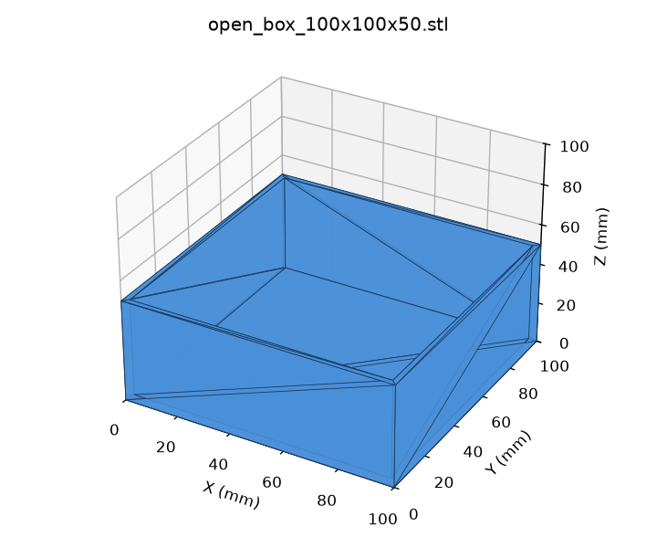

# boxgen

[](LICENSE)
[](https://www.python.org/downloads/)
[](https://github.com/1708018656-ship-it/boxgen)

[English](#english) | [简体中文](#简体中文)



> Early-stage project (v0.1, few stars). Small, focused, and already useful if you need printable STL boxes without CAD software.

---

## English

### Why boxgen?

3D-print makers and JLCPCB / print-service users often need a simple box, tray, or lid — but CAD is heavy, and many generators spit out non-manifold meshes that fail upload checks.

**boxgen** is a tiny CLI that emits **watertight, manifold STL** boxes in pure Python (zero runtime deps):

- **Closed** solid block
- **Open-top** container / tray (outer or cavity dimensions)
- **Slip-over lid** with clearance and skirt

Built for makers who care about print-service limits: single shell, outward normals, no bad edges, optional `--max-volume` for material caps (e.g. JLCPCB volume rules).

### Install (from GitHub)

```bash
git clone https://github.com/1708018656-ship-it/boxgen.git
cd boxgen
pip install -e .
# optional: pip install -e ".[dev]"     # pytest
# optional: pip install -e ".[preview]" # matplotlib preview
```

Requires Python 3.9+.

### CLI examples

```bash
# 1) Open-top tray — outer 100×100×50 mm, 2 mm walls
boxgen open --width 100 --depth 100 --height 50 --wall 2 -o tray.stl

# 2) Same tray sized by cavity (inner 50×30×20), then a matching lid
boxgen open --inner --width 50 --depth 30 --height 20 --wall 1.5 --floor 3 -o cavity.stl
boxgen lid  --width 53 --depth 33 --skirt 5 --clearance 0.3 -o lid.stl

# 3) Hit a material budget — solve height for 60 cm³, fail if over limit
boxgen open --width 100 --depth 100 --volume 60 --max-volume 60 -o box60.stl
```

Also: `python -m boxgen ...`, `--ascii` for ASCII STL, `boxgen <shape> -h` for full help.

### Python API

```python
from boxgen import open_box, closed_box, lid

m = open_box(100, 100, 50, wall=2, floor=2)
print(m.check())   # watertight, outward normals, volume_cm3, ...
m.to_stl("box.stl")
```

### Parameters (mm)

| Shape | Parameter | Default | Meaning |
|---|---|---|---|
| all | `--width`, `--depth` | required | outer footprint (`--inner` → cavity; `lid` → box outer size) |
| closed / open | `--height` / `--volume` | one required | outer height, or target material volume in cm³ (height solved) |
| open, lid | `--wall` | 2.0 | wall thickness |
| open | `--floor` | = wall | floor thickness |
| open | `--inner` | off | treat width/depth/height as cavity dimensions |
| lid | `--top` | = wall | top plate thickness |
| lid | `--skirt` | 5.0 | how far the lid overlaps the box |
| lid | `--clearance` | 0.3 | gap per side between box and lid |
| all | `--max-volume` | – | exit code 2 if material volume (cm³) exceeds it |
| all | `-o`, `--ascii` | binary | output path / STL format |

Sample STLs and a preview script live in [`examples/`](examples/).

### Roadmap

- Rounded corners / fillets
- Internal dividers (grid compartments)
- Inset (press-fit) lids and snap-fit tabs
- Text / label embossing
- 3MF export

---

## 简体中文

### 为什么用 boxgen？

做 3D 打印或往嘉立创等打印平台上传模型时，经常只需要一个简单的盒子、托盘或盒盖，但 CAD 太重，不少在线生成器还会产出非流形网格，过不了平台检查。

**boxgen** 是一个轻量命令行工具，用纯 Python（**零运行时依赖**）生成**水密、流形**的 STL：

- **封闭**实心块
- **开口**收纳盒 / 托盘（可按外尺寸或内腔尺寸）
- **外扣盒盖**（可调间隙与套入深度）

面向创客与 JLCPCB 等打印服务：单壳体、法线朝外、无坏边，可用 `--max-volume` 限制材料体积。

> 项目尚早（v0.1，星标很少），但已经能稳定产出可打印的盒子。

### 安装（从 GitHub）

```bash
git clone https://github.com/1708018656-ship-it/boxgen.git
cd boxgen
pip install -e .
# 可选：pip install -e ".[dev]"      # pytest
# 可选：pip install -e ".[preview]"  # matplotlib 预览
```

需要 Python 3.9+。

### 命令行示例

```bash
# 1) 开口托盘 — 外尺寸 100×100×50 mm，壁厚 2 mm
boxgen open --width 100 --depth 100 --height 50 --wall 2 -o tray.stl

# 2) 按内腔 50×30×20 生成，再做一个配套盒盖
boxgen open --inner --width 50 --depth 30 --height 20 --wall 1.5 --floor 3 -o cavity.stl
boxgen lid  --width 53 --depth 33 --skirt 5 --clearance 0.3 -o lid.stl

# 3) 卡材料体积 — 自动求高度使体积 = 60 cm³，超限则报错
boxgen open --width 100 --depth 100 --volume 60 --max-volume 60 -o box60.stl
```

也可用 `python -m boxgen ...`；`--ascii` 输出 ASCII STL；`boxgen <shape> -h` 查看完整帮助。

### Python 接口

```python
from boxgen import open_box

m = open_box(100, 100, 50, wall=2, floor=2)
print(m.check())   # 水密性、法线、体积等
m.to_stl("box.stl")
```

### 参数说明（单位 mm）

| 形状 | 参数 | 默认值 | 含义 |
|---|---|---|---|
| 全部 | `--width`、`--depth` | 必填 | 外部长宽（`--inner` 时为内腔；`lid` 时为盒子外尺寸） |
| closed / open | `--height` / `--volume` | 二选一 | 外高度，或目标材料体积 (cm³)，自动求解高度 |
| open、lid | `--wall` | 2.0 | 壁厚 |
| open | `--floor` | 同壁厚 | 底厚 |
| open | `--inner` | 关 | 长宽高按内腔尺寸计算 |
| lid | `--top` | 同壁厚 | 顶板厚度 |
| lid | `--skirt` | 5.0 | 盒盖套住盒子的深度 |
| lid | `--clearance` | 0.3 | 盒盖与盒子单边间隙 |
| 全部 | `--max-volume` | – | 材料体积超过该值 (cm³) 时以退出码 2 报错 |
| 全部 | `-o`、`--ascii` | 二进制 | 输出路径 / STL 格式 |

示例 STL 与预览脚本见 [`examples/`](examples/)。

### 路线图

- 圆角
- 内部隔板（分格）
- 嵌入式盒盖、卡扣
- 文字浮雕
- 3MF 导出

---

## License / 许可证

MIT © 1708018656-ship-it. See [CONTRIBUTING.md](CONTRIBUTING.md).
